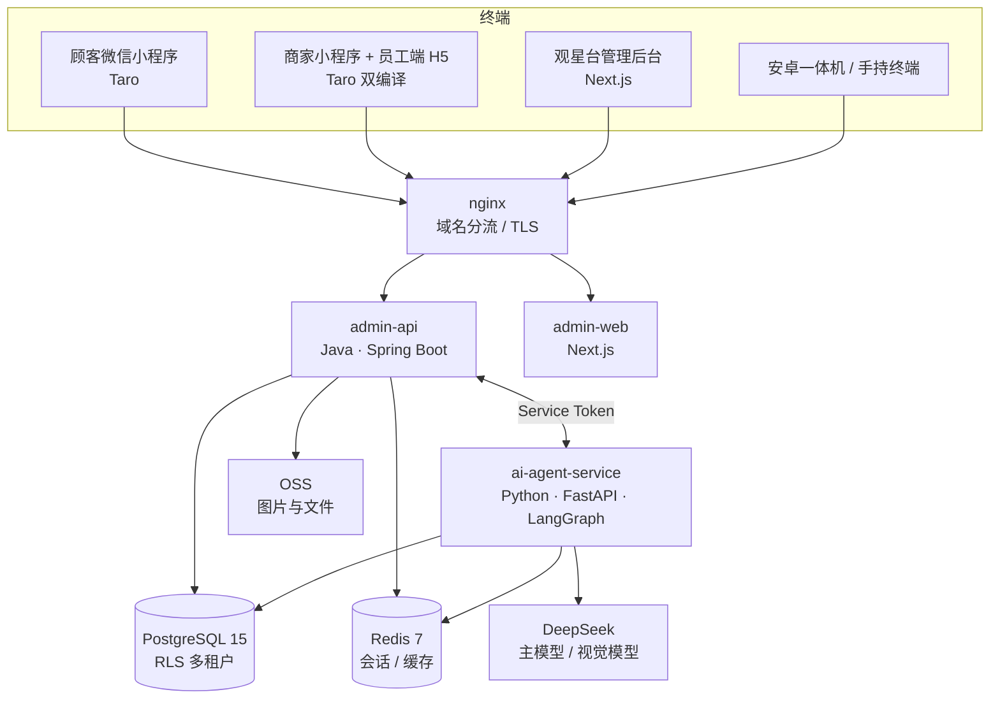

# 观星台（MIGAO）— 布艺行业 AI 经营平台

[](https://github.com/zhaokai-mgzn/migao/actions/workflows/pr-check.yml)
[](LICENSE)

> 面向布艺 / 窗帘商家的多租户 AI 经营平台：顾客侧由 **元元** 提供 7×24 智能客服与下单；
> 经营侧由 **黄金策** 覆盖商品、订单、生产、质量、仓储、财务与供应链。
> 业务闭环 = 询价算料 → 下单 → 生产（裁床 / 车位 / 后整）→ 入库 → 发货 → 售后与对账。
>
> 智能客服是「客户服务」能力域的一部分，不再代表系统的全部定位
> （定位沿革见 issue #6463 / 品牌改名见 issue #6525）。

## 🎯 产品定位

| 维度 | 事实 |
|------|------|
| **产品名** | 观星台 |
| **定位** | 布艺 / 窗帘行业的企业级 AI 经营管理平台 |
| **使用者** | 商家管理员与员工、终端顾客、车间工人 |
| **AI 分工** | 元元（C 端顾客服务）+ 黄金策（B 端经营助手） |
| **业务纵深** | 窗帘算料报价、SKU 矩阵（颜色 × 售卖方式 × 门幅）、加工项与工序、批次库存与移动加权成本、计件工资 |
| **部署形态** | 多租户 SaaS（租户级数据隔离，商家入驻 AI 自动甄别） |

本仓**不是**「通用行业 AI 客服模板」：默认行业模型就是布艺 / 窗帘，
行业术语、算料规则与生产工序都有可执行真值源（见「文档」一节）。

## ✨ 核心亮点

- **双 Agent** — 元元（顾客侧，LangGraph）+ 黄金策（经营侧），工具与 Skill 注册表驱动
- **四端协同** — 观星台后台、顾客微信小程序、商家小程序、员工端 H5 / 安卓终端
- **全链路经营** — 从算料报价、下单、生产报工、入库过账到发货、售后与财务对账
- **行业纵深** — 窗帘算料、工序路线、批次成本、余料台账、计件工资不是外挂，是主模型
- **多租户与权限** — JWT 派生租户 → MyBatis 拦截器 → PostgreSQL RLS → 字段脱敏；岗位权限逐人可配
- **可审核的 AI** — B 端口径卡先审核再进 prompt；写操作有边界、有确认卡、有审计记录
- **CI/CD** — GitHub Actions 门禁 + 服务器侧构建部署；行为用例单一源（`.github/cases/`）

## 🧭 四端与两位 Agent

### 四端

| 端 | 代码 | 使用者 | 主要能力 |
|----|------|--------|----------|
| **观星台管理后台** | `frontend/admin-web` | 商家管理员 / 员工 | 经营概览、报表、客户服务、订单商品、生产、质量、仓储、财务、供应链、组织 |
| **顾客微信小程序** | `frontend/mini-app` | 终端顾客 | 元元对话、算料报价、下单、订单与物流、售后、知识卡片、图片识别 |
| **商家小程序** | `frontend/bmini-app` | 商家 / 员工 | 黄金策移动版、经营一屏、移动坐席、工人工作台（H5 `/b/` 与小程序双编译） |
| **员工端 H5 / 安卓终端** | `frontend/bmini-app` 的 H5 编译 | 车间工人 | 扫码报工、入库、发货、返工、计件；安卓一体机 / 手持标签机 |

> `frontend/worker-h5`（线上 `/w/`）只服务**已印出的纸码**，处于兼容期、不再新增功能；
> 新的工人面统一做在 `frontend/bmini-app`。

### 元元 — C 端顾客服务

- 商品咨询：颜色、门幅、加工项，按店内已上架商品作答
- 窗帘算料报价：按尺寸与工艺计算用料，给出**估算**报价
- 下单：短信验证码校验，成交单价取商品库权威价
- 订单与物流：订单进度、物流轨迹、收货地址
- 售后受理：售后咨询与申请，工单恒为「待商家审核」
- 知识卡片与图片识别：只检索**已发布**卡片；顾客发图可识别解读

**能力边界**：不改价、不取消订单、不退款、不承诺优惠折扣、不报库存数量。

### 黄金策 — B 端经营助手

- 经营看板与每日简报：订单量、销售额、环比、待处理事项
- 商品与 SKU：批量改价、批量库存调整（可撤销）、商品改名、分类与资料维护
- 订单与加工单：订单查询、物流、加工单进度与报工明细
- 库存与入库：批次库存、库存台账、入库单与批次成本
- 生产与计件：工序库、工艺路线、计件工资报表
- 财务与客户：资金流水 / 收支汇总 / 应收对账问答，客户档案与售后工单
- 口径卡（Playbook）：会话中的纠正先落成 **draft** 卡，审核通过后才进入本企业 prompt

**能力边界**：可写的动作 = 改价、商品改名、批量改价与批量库存调整、通知标记已读、定时提醒；
上下架与删除不做；改价须携带改前价并经确认卡二次确认；AI 不创建订单与商品。

## 🏗️ 系统架构



- **业务真值在 admin-api**：价格、库存、权限、单据状态都由服务端裁决；AI 只经工具读写。
- **AI 服务与 admin-api 共用同一 PostgreSQL**：会话状态 / 记忆落库，但不持有独立业务库；
  业务能力经内部 API + Service Token 访问。
- **知识问答不用向量库**：知识卡片（结构化过滤 + 关键词）是唯一检索面（RAG 已随 issue #3051 移除）。
- **部署拓扑**：SWAS 单机容器 + RDS + Redis(Tair) + OSS，见 [docs/wiki/Deployment.md](docs/wiki/Deployment.md)。

## 🛠️ 技术栈

| 层级 | 技术 | 版本口径 |
|------|------|----------|
| **管理 API** | Java + Spring Boot + MyBatis-Plus + Spring Security | 见 `backend/admin-api/pom.xml` |
| **AI 服务** | Python + FastAPI + LangChain Core + LangGraph | 见 `backend/ai-agent-service/requirements.txt` |
| **管理后台 / 官网** | Next.js（App Router）+ React + TypeScript + Tailwind CSS | 见 `frontend/admin-web/package.json` |
| **顾客小程序** | Taro + React + TypeScript + Sass | 见 `frontend/mini-app/package.json` |
| **商家小程序 / 员工端** | Taro + React + TypeScript（H5 与小程序双编译） | 见 `frontend/bmini-app/package.json` |
| **数据库 / 缓存** | PostgreSQL + Redis | PG 15 / Redis 7 |
| **知识库** | PostgreSQL `knowledge_cards` 词条模型（结构化检索，无向量库） | — |
| **大语言模型** | DeepSeek（主模型 / 视觉模型由 `PRIMARY_MODEL` / `VISION_MODEL` 配置） | 见服务配置 |
| **认证** | RS256 JWT + 微信登录 + 短信验证码 | — |
| **部署** | 阿里云 SWAS + RDS + Redis(Tair) + OSS + GitHub Actions | — |

> **版本真值源（易变现值一律不在此抄数 —— 抄一份 = 第二个真值源，且没有任何东西会红；issue #5082）**
>
> - Java / Spring Boot / MyBatis-Plus：`backend/admin-api/pom.xml`
> - AI 服务依赖：`backend/ai-agent-service/requirements.txt`
> - 前端依赖：`frontend/admin-web/package.json` / `frontend/mini-app/package.json` / `frontend/bmini-app/package.json`
> - **业务工具**：以 `backend/ai-agent-service/app/tools/registry.py` 的注册表为单一源
>   —— 复算 `grep -cE '^[[:space:]]*registry\.register\(' backend/ai-agent-service/app/tools/registry.py`
> - **workflow 数量**：`ls .github/workflows/*.yml .github/workflows/*.yaml 2>/dev/null | wc -l`
> - **数据表**：以 `backend/admin-api/src/main/resources/db/init/schema.sql` 为单一源
>   —— 复算 `grep -ciE '^[[:space:]]*create table' backend/admin-api/src/main/resources/db/init/schema.sql`
>
> 守卫 = `tests/unit_ci_workflows/test_doc_present_value_guard.py`（登记面上一处写死现值即红）。

## 📦 能力地图

侧边栏与官网共用同一份能力口径，真值源 = `frontend/admin-web/src/config/menu.ts`：

| 能力域 | 菜单 |
|--------|------|
| **经营概览** | 经营概览 · 报表中心 |
| **客户服务** | 在线接待 · 售后工单 · 知识库 |
| **订单 / 商品** | 销售订单 · 商品管理 · 价格本 · 客户列表 |
| **生产管理** | 作业单 · 智能派单 |
| **质量管理** | 质检记录 · 返工单 |
| **仓储 / 物料** | 入库单 · 盘点单 · 出库单 · 发货单 · 库存明细 · 余料台账 · 省料分析 |
| **财务** | 财务对账 · 计件工资 |
| **供应链** | 采购单 · 供应商 |
| **组织管理** | 员工管理 · 岗位权限 |
| **独立入口** | 企业基础设置 · 通知中心 |

行业纵深与逐项能力说明见 [docs/wiki/Product.md](docs/wiki/Product.md)。

## 📁 项目结构

```
migao/
├── backend/
│   ├── admin-api/                 # Java 管理 API（业务真值 / 租户 / 权限 / 单据）
│   │   ├── src/main/java/com/migao/admin/
│   │   ├── src/main/resources/db/ # 唯一建库脚本 + 增量迁移 + 归档链
│   │   └── src/test/
│   └── ai-agent-service/          # Python AI 服务（元元 / 黄金策）
│       ├── app/agents/            # Agent 定义与 persona
│       ├── app/graph/             # LangGraph 状态图 + Skill
│       ├── app/tools/             # 业务工具（registry.py 为单一源）
│       ├── app/router/            # 意图分类（规则 + LLM）
│       └── tests/
├── frontend/
│   ├── admin-web/                 # 观星台后台 + 官网（Next.js）
│   ├── mini-app/                  # 顾客微信小程序（Taro）
│   ├── bmini-app/                 # 商家小程序 + 员工端 H5（Taro 双编译）
│   └── worker-h5/                 # 兼容期旧工人端静态页（/w/，不再新增功能）
├── deploy/                        # SWAS 部署脚本 / compose / nginx
├── docs/                          # wiki / design / deployment / testing / api / sql
├── tests/                         # 单元工作流守卫 / E2E / smoke
├── rbac/                          # 权限数据与迁移生成
├── scripts/                       # 研发与运维脚本（gate / 对账 / 发布）
└── .github/                       # CI/CD、行为用例（cases/）、CI 辅助脚本
```

## 🚀 快速开始

### 前置条件

| 工具 | 最低版本 | 用途 |
|------|---------|------|
| JDK | 21 | admin-api 编译运行 |
| Node.js | 18+ | 四个前端包 |
| Python | 3.11+ | ai-agent-service |
| Docker + Docker Compose | — | 本地数据库（可选；默认连云 dev） |

### 本地开发（三组件 + 云 dev 数据库）

本地默认只起 **admin-api(:8080) + ai-agent-service(:8001) + admin-web(:3001)**，
数据库 / Redis 连云 dev。首次需要把当前公网 IP 加入 RDS 白名单：

```bash
./scripts/dev-db-whitelist.sh          # 诊断（不写云资源）
./scripts/dev-db-whitelist.sh --yes    # 不在列 ⇒ 只追加 + 回读确认 + TCP 复测
```

```bash
# 1. AI Agent（宿主端口 8001；容器内才是 8000）—— 先起，admin-api 要调它
cd backend/ai-agent-service
python3 -m venv .venv && .venv/bin/pip install -r requirements.txt
cp .env.example .env
.venv/bin/python -m uvicorn app.main:app --host 127.0.0.1 --port 8001 --reload

# 2. Admin API（:8080）
# ⚠️ AI 接线两个变量必须显式给，否则真实入驻静默 fail-closed 回「系统繁忙」
cd backend/admin-api
cp .env.example .env
set -a && . ./.env && set +a
export AI_AGENT_BASE_URL=http://localhost:8001
export AI_AGENT_SERVICE_TOKEN="$(grep -E '^SERVICE_TOKEN=' ../ai-agent-service/.env | cut -d= -f2- | tr -d '\"')"
./mvnw spring-boot:run

# 3. 观星台后台（:3001）
cd frontend/admin-web
npm install
npm run dev
```

> 详细排查（RDS 白名单、AI 接线症状、worktree 依赖）见
> [docs/wiki/Quick-Start.md](docs/wiki/Quick-Start.md)。
> 也可以用 `cd deploy && docker-compose up --build` 起数据库与双后端。

### 其它端

```bash
# 顾客小程序（微信开发者工具打开 dist/）
cd frontend/mini-app && npm install && npm run dev:weapp

# 商家小程序 / 员工端 H5
cd frontend/bmini-app && npm install
npm run dev:weapp     # 小程序
npm run dev:h5        # H5（/b/）
```

## 🧪 测试

```bash
# 提交前（与 CI 同规则）
./verify-all.sh gate          # 三模块测试 + QA gate 预检（全量档，需机器级重活锁）
./check-ui-regression.sh      # UI 回退检测（改了 web 面才需要）
./contract-check.sh           # 三端契约一致性（跨模块改动）

# 分模块
cd backend/admin-api && ./mvnw test
cd backend/ai-agent-service && .venv/bin/python -m pytest
cd frontend/admin-web && npx vitest run && npx tsc --noEmit
cd frontend/bmini-app && npm test

# E2E / 冒烟
cd tests && npx playwright test
cd tests/smoke && pytest
```

测试工程规范（拆分 / ignore / 脱敏 / 分层）见
[docs/testing/test-engineering-standards.md](docs/testing/test-engineering-standards.md)。

## 🚢 部署

合并到 `main` 后按变更路径自动触发部署；构建发生在服务器侧（SWAS 上就地构建），
CI 只跑测试与部署编排。

| 工作流 | 触发 | 说明 |
|--------|------|------|
| `deploy-admin-api` | push main（`backend/admin-api/**`、`deploy/swas/**`）/ tag | 测试 → 服务器侧构建 → 部署 → post-deploy 冒烟 |
| `deploy-ai-agent-service` | push main（`backend/ai-agent-service/**`）/ tag | 同上 |
| `deploy-frontend` | push main（`frontend/admin-web/**`）/ tag | tsc + vitest → 构建 → 部署 + 域名探测 |
| `c-end-h5-publish` | push main（`frontend/mini-app/**`）/ 定时 / 手动 | C 端 H5 静态发布（定时只报告，写盘需 `publish=true`） |
| `worker-h5-publish` / `bmini-h5-publish` | 定时 / 手动 | 静态 H5 发布腿（`/w/` 兼容期旧页、`/b/` 员工端） |
| `terminal-publish` | 手动（需 Release tag） | 安卓终端安装包发布 |
| `release` | 手动 | 打 semver tag + Release notes |
| `deploy-prod` | 手动（生产审批） | 受控发布（尚未启用） |

- 镜像 tag = git SHA 前 7 位，可追溯；`gh workflow run deploy-<svc>.yml -f image_tag=<tag>` 可回滚。
- 回滚与发布口径见 [docs/wiki/Deployment.md](docs/wiki/Deployment.md)、
  [docs/deployment/rollback.md](docs/deployment/rollback.md)。

## 📖 文档

| 场景 | 入口 |
|------|------|
| **全部文档索引** | [docs/wiki/INDEX.md](docs/wiki/INDEX.md) |
| **产品定位与能力地图** | [docs/wiki/Product.md](docs/wiki/Product.md) |
| 系统架构 | [docs/wiki/Architecture.md](docs/wiki/Architecture.md) |
| 本地搭建 / 运行 | [docs/wiki/Quick-Start.md](docs/wiki/Quick-Start.md) |
| 开发流程与验证命令 | [docs/wiki/Development.md](docs/wiki/Development.md) |
| AI 服务 / Agent 能力 | [docs/wiki/AI-Agent.md](docs/wiki/AI-Agent.md) |
| 前端架构 | [docs/wiki/Frontend.md](docs/wiki/Frontend.md) |
| 数据库与迁移 | [docs/wiki/Database.md](docs/wiki/Database.md) |
| CI/CD 与部署 | [docs/wiki/CI-CD.md](docs/wiki/CI-CD.md) · [docs/wiki/Deployment.md](docs/wiki/Deployment.md) |
| 测试与验收 | [docs/wiki/Testing.md](docs/wiki/Testing.md) · [docs/testing/acceptance-protocol.md](docs/testing/acceptance-protocol.md) |
| 行业真值源 | [docs/curtain-fabric-quote-rules.md](docs/curtain-fabric-quote-rules.md)（算料）· [docs/curtain-production-process-standard.md](docs/curtain-production-process-standard.md)（工序） |

## 🤝 贡献指南

欢迎贡献！流程见 [CONTRIBUTING.md](CONTRIBUTING.md)：Issue 先行 → 分支 → 测试先行 → PR 门禁。

- **分支策略**：`main` 受保护，仅通过 PR 合入；`feat/*` / `fix/*` / `hotfix/*` / `docs/*`
- **PR 必须关联 Issue**（body 写 `Closes #<issue>`），CI 有 `pr-issue-link` 检查
- **提交前**：`./verify-all.sh gate` + `./check-ui-regression.sh`（跨模块再加 `./contract-check.sh`）
- **新增 / 修改测试**：文件头声明 `# case_ids:`（对应 `.github/cases/`）

## 📄 许可证

[MIT License](LICENSE)
