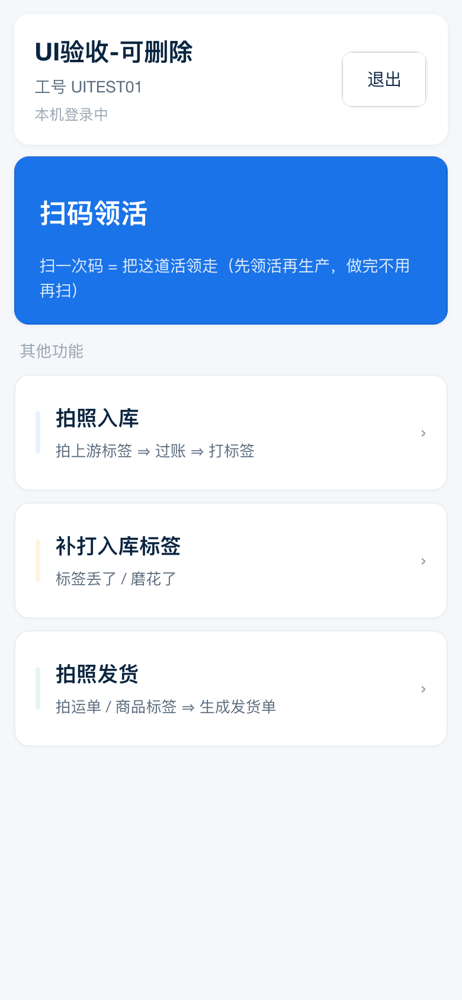

# 工人工作台「菜单」重排的合并前预览（issue #6858）

用户 2026-10-13 逐字：「这版本的**菜单主页**不太符合我们整体样式设计，为什么搞成纯白色背景了？」
+「为什么不能管理员登录后的主页菜单设计风格保持一致呢」+「工人登录后的页面菜单很少，通常只能看到 1-4 个菜单」。

## 结论链（怎么走到 V1 的）

1. **根因**：这一页还停在「三行白卡」的老结构 —— #6760 补了卡片边界、#6847 补了页面底色，**结构没动**；
   而 2026-10-12 已裁定的菜单设计（`docs/design/worker-home-menu.md` + `assets/worker-home-menu-390.png`）
   的语言是**身份条 + 主按钮 + 卡片**，**一直没落码**（#6764 停在「待派」）。
2. 我第一版猜的**渐变页头**（工人端「任务页」外壳）方向不对 —— 已撤掉。
3. 按「1~4 条」这个现实出三个候选（原型 `docs/design/prototypes/worker-home-menu-6858.html`：
   `?v=1|2|3&n=1|2|4`），用户选定 **V1 大卡列表**：
   - V1 行卡对 1~4 条都成立（行高固定、主按钮永远在第一屏）；
   - V2 宫格在 3 条时出「2+1」孤儿格、副标易折行；V3 分组在 1~2 条时「标题底下孤零零一张卡」。

## 本目录

| 文件 | 是什么 |
|---|---|
| `out/worker-home-v1-390.png` | **改后**（真实 Taro H5 构建产物）· 登录态 |
| `out/worker-home-v1-gate-390.png` | 改后 · 未登录态 |
| `preview-6858-v1.mjs` | 可复算的预览探针（打桩工人接口，不需要真后端） |
| `out/worker-home-menu-6858-v{1,2,3}-*.png` | 三个候选的对比图（选型记录，`docs/design/assets/` 同源） |

## 复算

```bash
cd frontend/bmini-app && npm run build:h5
python3 -m http.server 8099 --directory dist &
cd <repo>/tests && PREVIEW_BASE=http://127.0.0.1:8099 \
  node ../acceptance/2026-10-13-worker-home-6858-shell-preview/preview-6858-v1.mjs
```

实测读数（390×844）：身份条 `h=109.1`（姓名 33.3 / 工号 21.6 / 退出按钮 72.7×47.8）；
主按钮 `background=rgb(26, 115, 232)`、`h=141.6`；行卡 3 张 `[拍照入库, 补打入库标签, 拍照发货]`；
未登录态 `gate=true`、`primary=false`（不渲染写入口）。

## 部署后重放（线上 `app.migaozn.com/b/`，2026-10-13 22:46 +08）

合并 `d6a9cbe6f`（22:42:46 +08）→ 发布腿 `38415730753` success → 探针 `worker-home-6858-replay.mjs` 实测（390×844）：

| 读数 | 值 |
|---|---|
| 页面底 | `rgb(245, 247, 250)`（`.taro_page` 仍是 `rgb(255, 255, 255)` —— 本单不动全局） |
| 身份条 | `h=109.1`、白卡 + `rgba(10,37,64,0.06) 0 1.04px 4.16px`；姓名「UI验收-可删除」/「工号 UITEST01」/「本机登录中」/「退出」`72.7×47.8`（1px 描边） |
| 主按钮 | `h=141.6`、`background: rgb(26, 115, 232)`、白字标题「扫码领活」+ `rgba(255,255,255,0.86)` 副标 |
| 分组小标题 | 「其他功能」 |
| 行卡 ×3 | `h=97.6`：拍照入库（左条 `rgb(232,241,254)`）/ 补打入库标签（`rgb(255,244,224)`）/ 拍照发货（`rgb(230,246,238)`） |
| 未登录态 | `gate=true`、`primary=false`（不渲染写入口） |

原始读数：`out/worker-home-6858-live-readings.json`（探针 stdout 原样落盘，可复算）。




**修前对照**（#6847 部署后、本单之前）：同一页只有「当前工人」三行白卡 + 四条等权入口，**没有主按钮、没有副标** ——
见 `acceptance/2026-10-13-worker-home-6760-replay/out/worker-home-6847-surface-after.png`。

**复算**：

```bash
cd <repo>/tests
node ../acceptance/2026-10-13-worker-home-6858-shell-preview/worker-home-6858-replay.mjs https://app.migaozn.com
# 退出码 0 = 身份条 + 主按钮（#1a73e8）+ 3 张行卡齐备；非零 = fail-closed
```
