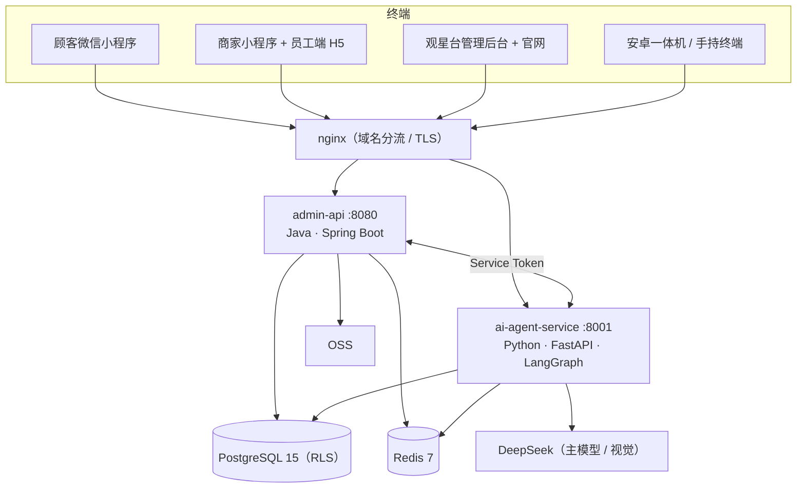

# 系统架构

> 事实页：服务拓扑、四端接入、数据层、多租户与 Agent 链路。
> **易变现值不写死**（表数 / 工具数 / 依赖版本一律现取，issue #5082）。

## 服务拓扑



- 本地开发只起 `admin-api` / `ai-agent-service` / `admin-web` 三个组件，数据库与 Redis 连云 dev
  （见 [Quick-Start](Quick-Start.md)）。
- 容器内 ai-agent 监听 8000，本地宿主映射 / 直起为 8001 —— 两个端口不能混用。
- 生产拓扑（SWAS 单机容器 + RDS + Redis(Tair) + OSS）见 [Deployment](Deployment.md)。

## 四端接入

| 端 | 协议 | 主要后端 |
|----|------|----------|
| 顾客微信小程序 | REST + SSE | admin-api（业务）/ ai-agent-service（对话） |
| 商家小程序 + 员工端 H5 | REST + SSE | 同上；H5 以 `/b/` 前缀由 nginx 分流 |
| 观星台管理后台 | REST + SSE | 同上；官网为公开页面 |
| 安卓终端 | HTTP（扫码 / 报工） | admin-api |

`frontend/worker-h5` 是**兼容期旧页**（线上 `/w/`），只为已印出的纸码服务，不再新增功能。

## 多租户隔离（5 层）

1. JWT 提取 `tenant_id`（不可伪造）
2. Spring Security RBAC 校验
3. MyBatis 拦截器自动注入 `tenant_id` → SQL `WHERE`
4. PostgreSQL RLS 行级安全（业务表启用）
5. 字段脱敏（日志 / 响应）

> 旧版第 5 层是「DashVector 分区键隔离」—— 向量库已随 RAG 移除（issue #3051），
> 知识检索改为 `knowledge_cards` 按租户过滤，隔离面不变。

## 数据模型（按域，表数不写死）

真值源 = `backend/admin-api/src/main/resources/db/init/schema.sql`
（复算命令见 [Database](Database.md)）。

| 域 | 代表表 | 说明 |
|----|--------|------|
| 租户 / 认证 | `tenants` / `tenant_apps` / `tenant_ai_configs` / `users` / `user_identities` | 多租户 + 多渠道身份 |
| RBAC | `roles` / `permissions` / `user_roles` / `role_permissions` | 岗位权限 |
| 商品 / 价格 | `products` / `product_skus` / `product_colors` / `product_attributes` / `customer_sku_prices` / `vip_level_prices` / `sku_tier_prices` | SKU 矩阵 + 价格本 |
| 订单 / 售后 | `orders` / `order_items` / `order_logistics` / `order_shipments` / `after_sales_tickets` / `ticket_timeline` | 订单全生命周期 |
| 生产 / 质量 | `processing_orders` / `production_operations` / `production_routings` / `production_work_logs` / `quality_inspections` / `rework_orders` / `piecework_settlements` | 工序、报工、质检、计件 |
| 仓储 / 供应链 | `warehouses` / `inbound_orders` / `outbound_orders` / `stock_batches` / `stock_ledger_entries` / `stocktakes` / `purchase_orders` / `suppliers` | 批次库存 + 盘点 + 采购 |
| 财务 | `finance_transactions` / `receipt_allocations` / `approvals` | 资金流水 / 对账 / 审批 |
| 客户 / 对话 | `customer_profiles` / `customer_tags` / `sessions` / `session_messages` / `agent_sessions` / `agent_messages` | CRM + C 端 / 坐席会话 |
| 知识 / 学习 | `knowledge_cards` / `knowledge_candidates` / `playbooks` / `playbook_reproductions` | 知识卡片 + 口径卡 |
| 系统 | `notifications` / `notification_rules` / `audit_logs` / `scheduled_tasks` / `client_request_keys` | 通知 / 审计 / 定时任务 |

完整清单与迁移机制见 [Database](Database.md)。

## AI 对话流（LangGraph StateGraph）

```
消息 → 意图分类（L1 规则 + L2 LLM）→ Skill 选择 → Plan（工具列表）
     → Execute（调用工具）→ Verify（检查）
     → 追问澄清? → 回到 Execute : → Response（含 confirm / form / choice 卡）
     → SSE 流式推送
```

- **双 persona**：元元（C 端）与黄金策（B 端）共用同一张图，工具集由 persona 的 skill 绑定决定。
- **工具注册表是单一源**：`backend/ai-agent-service/app/tools/registry.py`；能力声明必须与注册表一致。
- **写操作边界**：B 端只读化 + 可逆写白名单（改价 / 改名 / 批量库存 / 通知已读 / 提醒），
  详见 [agent-write-boundary](agent-write-boundary.md)。
- **能力误宣防护**：prompt 点名的工具必须在裁剪后可执行集内（判据在 `ai-agent-service` 测试内）。

## 认证

| 场景 | 流程 |
|------|------|
| 顾客小程序 | `wx.login()` → code → JWT（RS256） |
| 管理后台 | 用户名 + 密码 → JWT（RS256） |
| 商家小程序 / 员工端 | `用户名@企业编码` + 密码 → JWT（租户只由企业编码解析） |
| 服务间 | `X-Service-Token` 中间件（空配置 fail-closed） |

## 前端路由（admin-web）

当前是 App Router 的**路由组**，不再有 `/admin/*` 前缀：

| 路由组 | 典型路径 | 说明 |
|--------|----------|------|
| `(dashboard)` | `/dashboard` / `/orders` / `/products` / `/production` / `/inventory-*` / `/finance` / `/employee*` / `/roles` | 观星台经营后台（菜单真值源 `src/config/menu.ts`） |
| `(corporate)` | 首页 / `/services` / `/about` / `/contact` / `/download` | 官网企业站 |
| 根路由 | `/login` / `/register` / `/change-password` | 认证与首登改密 |

域名分流在 `frontend/admin-web/src/proxy.ts`（Next.js 16 起取代旧的 `middleware.ts` 命名）：
裸域走官网，`merchant.migaozn.com` 走经营后台。详见 [Frontend](Frontend.md)。
